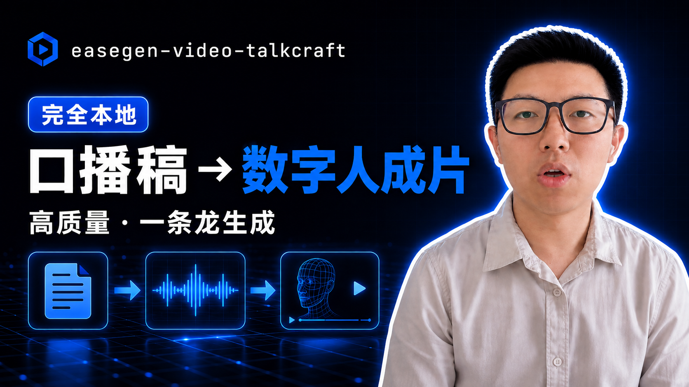

<div align="center">


<h1>easegen-video-talkcraft</h1>

[](https://vincentwei1021.github.io/video-talkcraft/)
[](LICENSE)

**A local-first digital-human video Skill: IndexTTS2 · local avatar runtimes · 108 motion cards · Remotion · triple-gate QA**

[中文](README.md) | [English](README_EN.md)

</div>

**easegen-video-talkcraft** is an Easegen-enhanced distribution of
[Vincentwei1021/video-talkcraft](https://github.com/Vincentwei1021/video-talkcraft).
It preserves the upstream 108 motion cards, SHOTBOOK system, workbench, and QA gates,
while adding a local-first Plus pipeline that can turn a script, an authorized
voice reference, and avatar footage into IndexTTS2 narration and locally generated
presenter footage before rendering with [Remotion](https://www.remotion.dev/).

> This repository does not bundle model weights, CUDA environments, third-party native binaries,
> private voices, or avatar assets, and it has no automatic remote-GPU fallback. Upstream code
> remains under PolyForm Noncommercial 1.0.0; commercial use requires upstream authorization.



## 🙏 Special thanks to video-talkcraft

This project is built on Vincent Wei's
**[video-talkcraft](https://github.com/Vincentwei1021/video-talkcraft)**.
We sincerely thank Vincent Wei and the upstream contributors for the narration-video workflow,
108 motion recipe cards, SHOTBOOK cinematography system, Remotion templates, motion workbench,
and machine-verifiable QA methodology. Easegen Plus adds IndexTTS2 and local digital-human
integration on top of that foundation.

If this project helps you, please also follow and support the upstream author:
**[GitHub · Vincentwei1021/video-talkcraft](https://github.com/Vincentwei1021/video-talkcraft)**.

> The methodology docs and recipe cards are written in Chinese — the toolkit is
> built Chinese-narration-first (mixed Chinese/English narration is fully
> supported). Agents read them natively.

🖼️ [**Browse all 108 motion previews in the live Gallery »**](https://vincentwei1021.github.io/video-talkcraft/)

[](https://vincentwei1021.github.io/video-talkcraft/)

## ✨ Easegen Plus additions

- Local IndexTTS2 narration on CPU/CUDA and other devices supported upstream.
- Native Windows `heygem-win-onnx` (no WSL), Linux `heygem-local`, HeyGem API compatibility,
  and an experimental DH_live CPU path.
- A standalone adapter that keeps model runtimes isolated from Easegen's production
  Redis, API, object-storage, and scheduler code.
- Deterministic artifacts and acceptance checks for audio, presenter video, timing,
  face-safe zones, and the TalkCraft handoff.

See [the Plus pipeline reference](references/plus-pipeline.md) for setup and honest hardware boundaries.
The [native Windows guide](references/windows-onnx.md) documents batch-1 defaults,
threaded workers, isolated outputs, measured VRAM and limitations; CUDA is still required.

For the new shared Remotion runtime on native Windows, use `node runtime/windows-runtime.mjs check --upgrade`
and `node runtime/windows-runtime.mjs link <project-root>`; Linux/macOS use the upstream Bash scripts.
Windows uses directory junctions and does not require WSL.

## 🖥️ VRAM requirements: can a 4 GB GPU run it?

**The verified GPU is an NVIDIA RTX 2070 with 8 GB VRAM. A user reported an out-of-memory failure on a 4 GB card; 6 GB has not passed hardware acceptance. The minimum VRAM requirement remains unknown.**
This does not mean the model necessarily needs 8 GB, nor does it justify a claim that 4 GB is sufficient. The following applies only to the native Windows `heygem-win-onnx` avatar backend:

| GPU configuration | Verification status |
| --- | --- |
| NVIDIA RTX 2070 8 GB | Short-clip synthesis and audiovisual acceptance passed. Other GPU models still require runtime compatibility checks. |
| NVIDIA 4 GB | User-reported out-of-memory failure; not a supported configuration. |
| NVIDIA 6 GB | No completed hardware acceptance; success is not guaranteed. |
| No NVIDIA CUDA GPU / CPU-only | Not supported by this HeyGem backend; CPU-only avatar generation remains future research. |

With **batch 1, GFPGAN enhancement off, FP32, 480×832 at 30 fps and about 2.05 seconds of narration**,
sampled whole-GPU peak usage was **2941–2948 MiB (about 2.88 GiB)**, including desktop and other applications.
Observing roughly 3 GB usage on an 8 GB card is not a successful 4 GB hardware test. GPU model, driver,
resolution, enhancement settings and competing applications can affect the result.

For a low-VRAM experiment, use `--dh-batch-size 1`, leave `--dh-face-enhancement` disabled, run one job at a time,
and validate a short clip first. IndexTTS2 can use `--tts-device cpu`, at the cost of speed. These measurements
cover **only the avatar stage**, not the minimum requirements of the complete IndexTTS2 + avatar + Remotion
pipeline, long-form video, or 1080p/4K output. See the [Windows guide](references/windows-onnx.md) for the full test record.

## 🧩 Obtaining a HeyGem / avatar runtime

The HeyGem runtime and model files are too large to commit to this repository. Choose one of these paths:

1. **Contact the Easegen maintainer**: scan the WeChat QR code below and include `easegen` in the request to discuss paid deployment, environment setup,
   low-VRAM adaptation, or an independently delivered runtime package where redistribution is authorized.
   The paid service covers installation and integration; third-party model, image, and commercial-use rights
   remain governed by their own licenses and authorization documents.
2. **Build from the official project**: clone
   **[duixcom/Duix-Avatar](https://github.com/duixcom/Duix-Avatar)**, follow its Docker/model setup,
   and either add an Easegen compatibility layer that maps the official `/easy/submit` and `/easy/query`
   endpoints to `/api/v1/easedh/task/create` and `/api/v1/easedh/task/result`, or adapt a local inference
   entrypoint to the `EASEGEN_RESULT_JSON` contract used by `heygem-local`.

> The official checkout cannot be used directly as `--dh-engine-root`, and its port `8383` cannot be
> passed directly as the current `--dh-api-base`; both paths require the documented contract adaptation.

In both cases, review the current HeyGem/Duix code, model, Docker-image, redistribution, and commercial-use terms.

<p align="center">
  
  <br>
  <sub>Project collaboration and technical discussion: include easegen in your WeChat request</sub>
</p>

## 🆕 What's new
<!-- Style rule: one sentence per entry, ≤ 350 characters including the pointer link, stating what it is and what behaviour changed; details, parameters and card lists point to references / SKILL.md sections instead of being expanded here. Keep zh and en in sync. Set by PR #12 (2026-09-05); #14/#18 drifted back to long paragraphs, tightened again 2026-09-07. -->

**2026-09-11**

- ✂️ **Voice pre-trim `scripts/voice_trim.py`** — a human recording is now cleaned before timestamping, using the script as ground truth to cut filler words / stutters and re-takes / over-long pauses (only insertions absent from the script are cut, ASR mishearings of scripted characters never are); word timings come from FireRed ASR, a per-character SRT or a word-level JSON, cut points snap to the frame grid, and the same EDL can trim the host video so audio and picture stay frame-aligned (→ SKILL.md ②-0).
- 🫥 **Workbench: right-click → export with alpha** — right-click any motion clip on the timeline to render just that clip as a transparent video (MOV ProRes 4444 or WebM VP9 alpha) with a transparent canvas, the card's root backdrop and host-silhouette placeholder stripped automatically, ready as an overlay in CapCut / Premiere / After Effects; the same menu carries split / duplicate / delete (→ `workbench/GUIDE.md` ⑦).
- 📺 **Workbench live production board (L1)** — the workbench now attaches as soon as the ⑤-1 skeleton exists and stays open: a stage bar, a per-shot progress track (placeholder / implemented / rendered / passed / stale / open-issue dot), a shot view (single-shot preview, issues, SHOTBOOK excerpt) and a live composition card; status is derived from on-disk artifacts, `scripts/pipeline_state.mjs --pass/--issue` only records human verdicts, and half-written code no longer blanks the page (→ SKILL.md ⑤-2, `workbench/docs/live-pipeline.md`).
- 🔗 **Hardened workbench project linking** — `kbsrc` now resolves through the real path, each contract module falls back to its stub individually, and `src/kb/` normalises export shapes: linking a regular skill-built project (`Main.tsx` + `scenes/`, no promo modules) no longer 500s the whole page, and "拆解导入" (split import) disables itself with a reason when the contract isn't met (→ `workbench/README.md`, "接入口播成片工程").

**2026-09-09**

- 🎬 **First shot before the rest** — step ⑤ now scaffolds the whole composition with placeholder shots, builds only the sample shot, renders it as a single-shot preview with `--seg-audio` (no full audio track) for user sign-off, and only then builds the remaining shots; ⑥-1.5 keeps just the "full render or shot by shot" question (→ SKILL.md ⑤-1).

**2026-09-07**

- ✏️ **G5 line-art schematic system** — every text-only shot must carry an icon + box + arrow line drawing, text is never placed bare, at least one visible change per sentence, and preflight WARNs when that companion row is missing (→ `template/motion-systems/schematic.tsx`, `references/schematic.md`).
- 🎞️ **Eight video theme frames + chapter theme layer** — a single-video shot must sit inside one themed frame (browser window / film / instant photo / blueprint and four more; one frame per film, no fake player), and chapter cards switch colours plus a line-art motif per chapter (→ `template/components/theme-frame.tsx`, design-language §1.3).

**2026-09-05**

- 🔁 **19 cards ported from video-shotcraft (89 → 108)** — two review rounds over the sister library [video-shotcraft](https://github.com/Vincentwei1021/video-shotcraft) kept 19 (freeze-frame annotate removed 2026-09-06, 18 remain), each tsx rewritten to this library's self-contained contract, source cited (→ batch ◎ in `references/taxonomy.md`).
- 🎨 **Domain-driven style and card skinning** — derive a style profile from the script's domain before storyboarding (SHOTBOOK G0); library cards are neutral UI and are re-skinned to that profile without touching their motion vitals, one skinning line per shot (→ `references/design-language.md` §0).
- 🧩 **10 new multi-asset cards (79 → 89)** — parallel-sentence layouts, triptych relay, compare slider, filmstrip, stack fan-out, gallery-wall dolly / timeline photo strip and more; every card lists its input types and common scenarios, so card selection starts by filtering on the shot's material (→ input-type index in `references/taxonomy.md`).
- 📐 **Layout spec `references/layout.md`** — 12-column grid, spacing tokens, minimum type sizes, non-overlapping boxes and a 9-point still check; each chosen card's pitfalls / placement checks must be copied into the SHOTBOOK.
- 🎨 **12 dynamic backdrops shipped** — `template/motion-systems/backdrop.tsx`, 6 dark / 6 light, frame-driven with zero randomness; defaults are now light `pastel-mesh-flow` / dark `mesh-flow-dark`.

**2026-09-04**

- 🎥 **Motion system slimmed down** — one very slow push / pull camera curve per scene plus the yield lifecycle; idle wobble, breathing and pulses are off by default.
- 🌐 **Web pages are filmed, not pasted** — pages are shot by the camera (scroll, tour, magnifier, highlighter) instead of appearing as static screenshots, with every coordinate read from Playwright measurements (→ SKILL.md §③, `references/shot-design.md` §2④).

**2026-09-02**

- 🎛️ **Motion workbench `workbench/`** — a CapCut-style post-production desk for finished videos: multi-track timeline,
  library (media / motion cards / SFX / backgrounds), schema-driven inspector, live preview and one-click **Export**.
  All 108 motion cards are parameterized (copy, colors, sizes, positions editable; timing vitals stay fixed).
  A narration video can be split into seven kinds of editable units — subtitles / transitions / environment /
  avatar / shots / voiceover / SFX. The skill opens it for you after delivery. → [**Illustrated guide (zh)**](workbench/GUIDE.md)

  <a href="workbench/GUIDE.md"></a>

- ⚡ **Faster renders: shot-segmented master rendering** — `scripts/render_shots.mjs` renders per-shot segments in
  parallel (single-process inside each segment to keep rasterization consistent), then concatenates, mixes in the
  full audio track and asserts frame counts; changing one shot re-renders only that segment ± neighbours.
  `scripts/render_stills.mjs` renders batches of stills from a single bundle.
- 🧮 **Fewer review tokens** — `scripts/contact_sheet.py` tiles QA frames into 3×4 sheets for the reviewer subagent;
  burst triples are extracted only at anchors flagged `"burst": true` (they used to be 2/3 of the review material).
- ✅ **One review round, then deliver** — after the machine gates pass, a single independent review round fixes
  P0/P1 and the video ships; further rounds are opt-in (3 max) instead of "loop until clean".

| Measured (201 s vertical video) | Before | Now |
|---|---|---|
| Full first render | 13 min | 9 min |
| New video with audio after changing one shot | full re-render | 53 s |
| 43 sampled stills | 11 min | ~1 min |
| Reviewer reading 160 QA frames | ≈160k tokens / 21 min | ≈40k tokens / 7 min (sheets) |

- 🤝 New card: community-contributed **douyin-follow-card** ([@scpcn01vision-oss](https://github.com/scpcn01vision-oss)) — 79 cards total.

## ✨ Highlights

- **Word-level voiceover sync** — `scripts/timestamps_cpu.py` aligns
  your script to the audio (FireRedASR2-CTC int8 by default, faster-whisper as
  the zero-download fallback). Benchmarked against a GPU forced aligner on a
  110s mixed-language narration: median per-character offset 20–40 ms,
  worst case 200 ms, zero false QA flags. Every motion beat anchors to the
  exact word.
- **108 motion recipe cards** — each with intent, parameters, known pitfalls,
  a copy-paste self-contained Remotion tsx source, and a runnable HTML
  preview — browse them all in the
  [online Gallery](https://vincentwei1021.github.io/video-talkcraft/) or
  locally with `open gallery/index.html`. Kinetic type, data shots, evidence
  tours, six motion-carry transitions, a long-take world canvas, host
  compositing, and more.
- **A 7-layer anti-slideshow system** — one very slow push-in or pull-out camera
  curve per scene, a yield lifecycle and six motion-carry transitions (slimmed
  down on 2026-09-04: subject idle and the breathing environment are no longer
  required). Statically frozen
  frames are structurally impossible (and automatically detected if they
  slip through).
- **Layout discipline that survives review** — semantic-beat storyboarding,
  on-screen element budgets, whitespace anchors, pivot-sentence cut rules,
  and face safety zones measured by real detection
  (`scripts/face_bbox.py`), not by eye.
- **Triple-gate QA** — automated stillness detection, per-cue SFX energy
  verification on a solo track, and an independent-reviewer pass armed with
  anchor frames (plus burst triples at state-switch anchors, which catch
  time-domain defects single frames can't show).

## 🚀 Quick start

First-time Windows users: follow the [step-by-step setup and media guide (Chinese)](references/beginner-windows.md).
It covers Codex/WorkBuddy prompts, official IndexTTS-2 installation (no custom model changes required),
obtaining the separate avatar runtime from the **Easegen maintainer**, authorized voice/video inputs,
folder layout, exact commands, and the distinction between Plus handoff and final Remotion output.
The compatible packaged runtime's `--dh-engine-root` is its **`engine` subdirectory**.
No public Baidu Netdisk URL is configured yet; contact the maintainer through this repository's Issues
or the Easegen author QR code, not the upstream video-talkcraft author.

**The most direct way: hand the repo link to your agent.**
In Claude Code / Codex or a similar agent, just say:

```text
Install this skill for me: https://github.com/haojing8312/easegen-video-talkcraft
```

Or install with the [skills](https://skills.sh/) CLI / manually:

```bash
npx skills add haojing8312/easegen-video-talkcraft
```

```bash
git clone https://github.com/haojing8312/easegen-video-talkcraft.git
cd easegen-video-talkcraft
ln -s "$(pwd)" ~/.claude/skills/easegen-video-talkcraft   # Claude Code
# or
ln -s "$(pwd)" ~/.codex/skills/easegen-video-talkcraft    # Codex
```

Environment (the agent will set this up as needed):

- Node 18+ (Remotion render; `npm install` inside the per-video project)
- Python 3.10+
  - For local CPU timestamp alignment: `pip install zhconv pypinyin sherpa-onnx soundfile numpy`
    (downloads 767 MB FireRedASR2-CTC model once; or use `--backend whisper`)
  - For 1-step cloud TTS + timestamps (Fish Audio free tier): `pip install requests python-dotenv`
- ffmpeg

Then make requests like:

```text
Use easegen-video-talkcraft to turn this narration script + voiceover.wav into a video.
Make a 100-second explainer about <topic>; here is the script and the audio.
Use the Plus pipeline to turn this script, voice reference, and avatar clip into a digital-human video.
```

### 🎙️ Optional: Fish Audio voiceover + character timestamps

Finished voiceover plus local CPU alignment remains the default workflow. When you need to synthesize narration, opt into Fish Audio. The script requests `s2.1-pro-free` by default; free quota and model availability are controlled by Fish Audio.

1. Install `ffmpeg` and Python dependencies: `pip install requests python-dotenv`.
2. Copy `.env.example` to `.env` and set `FISH_AUDIO_API_KEY`. Optionally set `FISH_AUDIO_REFERENCE_ID` to a voice ID from the voice library; leaving it empty uses the service's default voice.
3. Prepare `script.json`, for example `{"sentences": ["First sentence.", "Second sentence."]}`. A JSON string array or a `.txt` file with one sentence per line also works.
4. Generate audio and timestamps:
   ```bash
   # Default: one request per sentence, with 0.25 seconds of actual silence inserted between requests
   python3 scripts/tts_fishaudio.py script.json audio/full.wav audio/timestamps.json --timing-out remotion/src/timing.json
   # One request for the whole script; retain the model's natural pacing
   python3 scripts/tts_fishaudio.py script.json audio/full.wav audio/timestamps.json --timing-out remotion/src/timing.json --mode stream
   ```

Both modes receive SSE audio and alignment snapshots. **Files are written after synthesis finishes; streaming playback is not implemented.** `--pause-sec` controls additional silence in sentence mode only. Each response is decoded to PCM before concatenation and encoding; offsets use actual decoded sample counts. `--format mp3|wav|opus` selects the API response format; the audio output extension selects the saved format.

Chinese characters retain API alignment spans; English character times are interpolated within each word, with zero-duration punctuation. Empty audio, missing/invalid alignment, decoding failures, and mismatched normalized text cause an error exit. Normalization ignores punctuation, case and character width; it does not guess spoken-number substitutions such as `2` versus `two`. Use spoken-form text for such cases, or use local CPU alignment with an existing recording. `match=1` / `ok=true` confirms text mapping, not pronunciation or independently verified timing accuracy; listen to the result.

Offline regression checks (no API key; requires `requests` and `ffmpeg`):
```bash
python3 -m unittest discover -s scripts -p 'test_*fish*.py' -v
```

## 🎞 What you bring vs. what it does

| You bring (inputs) | The skill does |
| --- | --- |
| Narration script | Word-level timestamp alignment, with per-sentence QA flags |
| Finished voiceover — any TTS or human recording | SHOTBOOK storyboarding: semantic beats, layer matrices, layout budgets |
| Optional host footage — ordinary video works (keying + face-zone tooling included; green screen keys cleanest) | Remotion implementation on four global systems (camera / parallax / yield / environment), transitions, SFX placement |
| Optional B-roll / screenshots | Render + triple-gate QA (machine gates all green + one independent review round with P0/P1 fixed, then deliver; optional extra rounds, 3 max), loudness-normalized delivery |

## 📦 What's included

| Content | Description |
| --- | --- |
| 108 motion recipe cards | Intent, energy, parameters, implementation notes, and known pitfalls — every card ships a self-contained Remotion tsx source (`template/cards/`, copy one file and go) plus a runnable HTML demo |
| Gallery | [Online](https://vincentwei1021.github.io/video-talkcraft/) or local (`open gallery/index.html`) — browse and autoplay all 108 previews, search by name/keyword |
| Motion systems | CameraRig (slow push/pull), yield lifecycle, six transitions, long-take world canvas; parallax and environment layer optional (`template/motion-systems/`) |
| Components | Plain-cut subtitles, flower-word titles, smash words, highlight sweeps, pencil draw, number rolls, eight video container frames (`template/components/`) |
| Pipeline scripts | Word-level timestamps (2 ASR backends), face-zone detection, stillness check, SFX presence check, QA frame extraction (`scripts/`) |
| Methodology | Design language (Apple-paradigm default), shot design worksheets, cinematography rules, storyboard format, QA rubrics (`references/`) |
| Embedded SFX | Per-card sound cue tables with real samples embedded in the demo lib (licenses in `demos/_lib/sfx/ATTRIBUTION.md`) |

## 🗂 Repository structure

```text
easegen-video-talkcraft/
├── SKILL.md                    # Agent entry point: the 8-step pipeline and hard rules
├── references/
│   ├── design-language.md      # Default visual system (palette/type/layout/subtitles)
│   ├── shot-design.md          # 3-plane worksheet + 7 shot-type presets
│   ├── cinematography.md       # 7-layer model, transitions, layout budget, QA gates
│   ├── shotbook-example.md     # A full storyboard example
│   ├── cards/                  # 108 motion recipe cards
│   ├── taxonomy.md             # Card index by category and source
│   ├── broll-sources.md        # Attribution-free stock sources (APIs, license traps)
│   ├── host-footage.md         # Host footage: input spec, keying, face safety zone
│   └── demo-spec.md            # Card/demo authoring spec
├── demos/                      # 108 runnable HTML previews (+ shared lib with embedded SFX)
├── gallery/                    # One-page local gallery
├── template/                   # Copy-paste Remotion code
│   ├── cards/                  # Per-card self-contained tsx sources (the skill's primary reference)
│   ├── motion-systems/         # Camera / parallax / yield / environment / transitions / long-take
│   └── components/             # Subtitles, flower words, smash words, pencil, etc.
└── scripts/                    # Timestamps, face bbox, QA tooling
```

For the full workflow, start at [SKILL.md](SKILL.md).

## ❓ FAQ

**What is video-talkcraft?**
An open-source AI agent skill (for Claude Code / Codex) that turns a narration
script plus a finished voiceover into a fully animated, voiceover-driven
explainer video. It is
not an editor and not a template site — the agent reads the methodology, picks
motion recipe cards, writes [Remotion](https://www.remotion.dev/) code, and
runs triple-gate QA to deliver a publish-ready explainer.

**What kinds of videos can it make?**
Landscape, voiceover-driven explainer videos: knowledge explainers, product
reviews, news breakdowns, opinion commentary. Designed Chinese-narration-first; mixed
Chinese/English narration is fully supported.

**What do I need to provide?**
A narration script (text) and a finished voiceover (any TTS or human
recording); host footage and B-roll are optional.

**Is it free?**
Free for personal, educational, and research use (PolyForm Noncommercial
1.0.0), and the videos you produce belong to you; commercial use of the
toolkit itself requires prior authorization (see below).

## 📄 License

[PolyForm Noncommercial 1.0.0](LICENSE) — free for personal, educational, and
research use. **Any commercial use of the toolkit requires prior
authorization** — email
[vincentwei1021@gmail.com](mailto:vincentwei1021@gmail.com) or open
a GitHub issue.

This repository preserves the upstream Git history, Required Notice, and license.
See [THIRD_PARTY_NOTICES.md](THIRD_PARTY_NOTICES.md) for the runtime boundary of
the Easegen additions. Source availability does not grant commercial-use or model-redistribution rights.

**Videos you produce with this skill belong to you.** If it helped, a mention
of the author's accounts in your video description is appreciated — and
entirely optional.

## 🔊 Audio and asset notes

- Embedded SFX samples: sources and licenses in
  [demos/_lib/sfx/ATTRIBUTION.md](demos/_lib/sfx/ATTRIBUTION.md).
- The B-roll sourcing guide only admits attribution-free stock (Pexels,
  Pixabay, Mixkit Free, Coverr, NASA) and documents the license traps of the
  ones it rejects — see
  [references/broll-sources.md](references/broll-sources.md).
- The demo host footage (`demos/_lib/dh-host.webm`) is an AI-generated
  presenter used as a placeholder; replace it with your own host footage in
  production.

## 🙏 Acknowledgements

- **[Remotion](https://www.remotion.dev/)** — the React video framework
  powering every render here (note its own
  [license](https://github.com/remotion-dev/remotion/blob/main/LICENSE.md)).
- **[FireRedASR2](https://github.com/FireRedTeam/FireRedASR2S)** via
  **[sherpa-onnx](https://github.com/k2-fsa/sherpa-onnx)** and
  **[faster-whisper](https://github.com/SYSTRAN/faster-whisper)** — the
  timestamp backends; **Qwen3-ASR/ForcedAligner** served as the benchmarking
  reference.
- **OpenCV YuNet** — the face detector behind the face-safety-zone rule.
- **Pexels · Pixabay · NASA · Mixkit** — attribution-free asset sources.
- **Claude Code** — this library was built, iterated, and QA'd with an AI
  coding agent, using the same review loops the skill teaches.

## Follow me

<p>
  <a href="https://x.com/VincentWei93"></a>
  <a href="https://www.douyin.com/user/MS4wLjABAAAAK1pkjBxilk2Oi_9h_vFyD-lTAu9CTlvhmOtkosDvvxg"></a>
  <a href="https://xhslink.cn/m/At9iP2d5C1V"></a>
</p>
